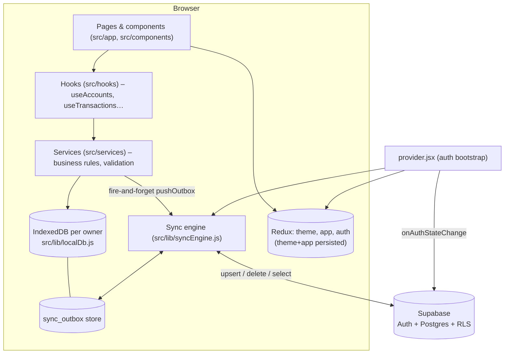

# Architecture

## 1. Tech stack

| Concern | Choice | Notes |
| --- | --- | --- |
| Framework | **Next.js 15.5** (App Router), **React 19** | `next dev --turbopack`; JavaScript (`.jsx`/`.js`), no TypeScript source (TS only as a dev dep; `jsconfig.json` provides the `@/*` alias) |
| Styling | **Tailwind CSS v4** + CSS variables | `src/app/globals.css` (`@import "tailwindcss"`, `@config "../../tailwind.config.mjs"`), class-based dark mode (`html.dark`) |
| Fonts | `next/font/google` | Caprasimo (display), Figtree (sans), JetBrains Mono (mono) — set up in `src/app/layout.jsx` |
| State | **Redux Toolkit** + **redux-persist** | Only `themeSlice` and `appSlice` are persisted (localStorage). Auth is *not* persisted — Supabase owns the session |
| Local DB | **IndexedDB** via `idb` | One DB per owner; this is the app's primary data store |
| Cloud | **Supabase** (Auth + Postgres + RLS) | Optional. App works fully without it |
| Charts | **recharts 3** | Lazy-loaded (`next/dynamic`) |
| Export | `pdf-lib` (PDF), custom RFC-4180 CSV builder | PDF lib is loaded lazily on export |
| OCR | **tesseract.js 7** self-hosted in `public/tesseract/` | + `heic2any` for iPhone photos |
| Voice | Browser Web Speech API | No library |
| Drag & drop | `@dnd-kit/*` | Reordering categories/buckets |
| Icons | `react-icons` (Heroicons v2 `hi2`, Ionicons) + 100+ SVGs in `public/icons/` | |
| Tests | **Vitest** (jsdom, fake-indexeddb) + **Playwright** | See [DEVELOPMENT.md](./DEVELOPMENT.md) |
| Hosting | Vercel (`https://spendscope-eta.vercel.app`) | Per `public/sitemap.xml` / `robots.txt` |

## 2. High-level picture



**Key idea — offline-first / local-first.** Every user action writes to IndexedDB immediately (and
adds an operation to the outbox if signed in). The UI is driven by local data, so it is instant and
works offline. The sync engine reconciles with Supabase in the background.

## 3. Layers and responsibilities

```
UI (pages/components)         -> render, user input, local UI state only
Hooks (src/hooks)             -> load data via services, subscribe to local data changes, expose actions
Services (src/services)       -> validation + business rules (transfers, delete cascades, reset, categories…)
Lib (src/lib)                 -> pure logic & infra: localDb, syncEngine, budgetMath, dateUtils,
                                 calculatorEngine, exports, OCR, voice, security, reminders
Redux (src/redux)             -> app-wide UI/auth/theme state (NOT the data of record)
```

Rules of thumb:
- Components never import `@supabase/supabase-js` or touch IndexedDB directly.
- Services are the only layer calling `localDb` mutating functions for domain entities.
- Pure computation (`budgetMath`, `calculatorEngine`, `expressionParser`, parsers) has no React/DOM
  dependencies and is unit-tested.

## 4. Folder layout

```
spendScope/
├── docs/                         # ← you are here
├── public/
│   ├── icons/                    # 100+ category/bucket SVG icons (keys in defaultSeeds.js ICON_GROUPS)
│   ├── avatars/                  # user_pf … user_pf9 profile avatars
│   ├── tesseract/                # self-hosted OCR worker, wasm cores, eng.traineddata.gz
│   ├── robots.txt, sitemap.xml, google…html (Search Console verification)
├── supabase/
│   ├── config.toml               # project_id (shared mobile DB), auth (min password 12), redirect URLs
│   ├── migrations/README.md      # intentionally no migrations: DB is owned by the mobile team
│   └── _archive_old_project/     # old project's + old web v2 schema (reference only)
├── tests/
│   ├── unit/*.test.js            # Vitest (13 files, 95 tests)
│   └── e2e/phase{1..6}-*.spec.mjs# Playwright (6 specs × 3 viewports = 18)
└── src/
    ├── middleware.js             # legacy-route redirects only (no auth gating — guest-first)
    ├── app/
    │   ├── layout.jsx            # root: fonts, <Providers>
    │   ├── provider.jsx          # Redux + PersistGate + theme bridge + auth/sync bootstrap
    │   ├── globals.css           # tokens, animations (ss-*), scrollbars
    │   ├── not-found.jsx         # custom 404
    │   ├── loading.jsx           # root loading (intentionally returns null)
    │   ├── loader-preview/       # dev-only loader showcase
    │   ├── (public)/             # landing, sign-in, signup, privacy-policy
    │   └── (private)/            # the app: dashboard, transactions, analytics, spend-bucket,
    │                             #   categories, calculators, settings/*   (+ legacy redirects)
    ├── components/
    │   ├── shared/               # AppShell, AppLockGate, AppLoader, modals, pickers, bars
    │   ├── transactions/         # TransactionFormModal, CalculatorKeypad, ExportModal, filters drawer
    │   ├── buckets/              # BucketFormModal, BucketEntryModal
    │   ├── analytics/            # AnalyticsCharts (recharts; lazy)
    │   ├── calculators/v2/       # CalculatorShell + 4 loan calculators
    │   ├── settings/             # SettingsSubpageHeader
    │   └── Header, Footer, ThemeChange, CategoryModal, CurrencySelect
    ├── hooks/                    # useAuth, useAccounts, useTransactions, useCategories, useBuckets, useLoanProfiles
    ├── services/                 # accounts, auth, buckets, categories, loanProfiles, preferences, reset, transactions
    ├── lib/                      # localDb, syncEngine, budgetMath, dateUtils, calculatorEngine, csv/pdf export,
    │                             #   receiptOcr, voiceParser, expressionParser, webSecurity, reminderScheduler,
    │                             #   defaultSeeds, supabaseconfig
    ├── redux/                    # store (persist), rootReducer, slices: auth, app, theme
    └── utils/                    # currencies.js, theme.js (token builder)
```

> Note: the 20 non-loan calculator components live under `src/app/(private)/calculators-m/components/`
> (a legacy folder name). The `/calculators-m` *route* only redirects to `/calculators`.
> `src/app/utils/theme.js` is an unused duplicate of `src/utils/theme.js` (see tech debt).

## 5. Routing

Route groups: `(public)` and `(private)` are organizational only — **both are accessible to guests**.
`(private)/layout.jsx` wraps pages in `<AppLockGate><AppShell>…`.

| Route | Purpose |
| --- | --- |
| `/` , (`/landing` → redirect to `/`) | Marketing landing page (Hero, Calculators, Categories, Features, CTA) |
| `/sign-in`, `/signup` | Supabase email/password auth; "Continue as Guest" |
| `/privacy-policy` | Static policy page |
| `/dashboard` | Overview: period filter, income/budget vs expense bar, category breakdown, recent transactions |
| `/transactions` | Full list, search, type/category filters, period filter, export (CSV/PDF), "Show more" paging |
| `/analytics` | Monthly donut by category + yearly income/expense bars |
| `/spend-bucket`, `/spend-bucket/[id]` | Spend Buckets (savings goals) list and detail with entries |
| `/categories` | Income/Expense categories CRUD, reorder, color & icon pickers |
| `/calculators` (`?type=<id>&category=<id>`) | Unified hub for 24 calculators |
| `/settings` + `/settings/{accounts,backup,budget-mode,hide-transactions,profile,reminders,reset,security,time-period}` | Settings hub and sub-pages |
| `/loader-preview` | Dev-only loader gallery (404 in production unless `NEXT_PUBLIC_ENABLE_LOADER_PREVIEW=1`) |
| `/calculators-m`, `/calculators-m/calculating`, `/spend-budget`, `/landing` | Legacy URLs → redirected by `src/middleware.js` (query string preserved) |

`src/middleware.js` matcher excludes `api`, `_next/static`, `_next/image`, favicon and image files.

## 6. State management

- **Redux slices** (`src/redux/slices`):
  - `authSlice` — `{authReady, isGuest, userId, email, profile, userData, token}`. Written only by
    `provider.jsx` / `useAuth` from Supabase events. Not persisted. Legacy cookies `token`/`use_role`
    are cleared on boot (`clearLegacySessionArtifacts`).
  - `appSlice` — `activeAccountId`, `sidebarCollapsed`, `isAppLocked`, `syncStatus`
    (`idle|local|syncing|synced|offline|error`, `pendingCount`, `lastSyncAt`, `lastError`), `quickAddOpen`.
  - `themeSlice` — `mode` (`light|dark`), `customAccent`, `tokens`, `colors` (built by `utils/theme.js`).
  - `emptyStore` action (in `redux/actions.js`) resets auth.
- **Persistence:** `redux-persist` key `root`, version 2, whitelist `["themeSlice","appSlice"]`,
  localStorage on the client and a no-op storage on the server. `PersistGate` shows `<AppLoader />`
  until rehydrated.
- **Server data is not in Redux.** Hooks hold data in React state and refresh on
  `subscribeDataChanged` events from `localDb` (scoped by `detail.storeName` so, e.g., accounts
  hook ignores transaction writes).

## 7. App boot sequence (`src/app/provider.jsx`)

1. `Providers` → Redux `Provider` → `PersistGate` (loader) → `ReduxThemeBridge`.
2. `ReduxThemeBridge`:
   - Applies the theme: toggles `html.dark` and sets CSS variables inline on `<html>` from
     `buildTheme()` tokens (see [DESIGN_SYSTEM.md](./DESIGN_SYSTEM.md)).
   - Clears legacy cookies, subscribes to sync-status events → `appSlice.syncStatus`.
   - If Supabase isn't configured → **guest bootstrap**: `enterGuestMode`, `ensureDefaults(null)`.
   - Else `supabase.auth.getSession()`:
     - session → `hydrateAuthenticated`: `getProfile`, `setAuthSession`, `syncNow(userId)`.
     - none → guest bootstrap.
   - `onAuthStateChange`: `SIGNED_OUT` → guest; `SIGNED_IN | TOKEN_REFRESHED | USER_UPDATED` → hydrate.
   - Separate effect (when signed in): `syncNow` on `online`, window `focus`, and `visibilitychange`.
3. `(private)/layout.jsx` → `AppLockGate` (PIN/passkey screen if enabled, re-locks after 60 s hidden)
   → `AppShell` (sidebar/bottom nav, account switcher, sync pill, banners).

## 8. App shell (`components/shared/AppShell.jsx`)

- Desktop collapsible sidebar (primary nav + Settings + sync pill); mobile bottom nav (4 items + "More" sheet).
- Top bar: **account switcher**, light/dark toggle, accent palette modal, user menu or "Back up / Sign In".
- Banners: offline notice, sync error with "Retry Sync", guest→cloud backup prompt
  (`getGuestMigrationSummary`), account reminder banner.
- Reminder check runs on mount, every 60 s and on window focus
  (`checkAndTriggerAccountReminder`).
- Sign-out dialog: keep offline copy, or wipe local IndexedDB for that user (`deleteOwnerDb`).

## 9. Cross-tab / custom events

| Event (window) | Emitter | Purpose |
| --- | --- | --- |
| `spendscope:data-changed` | `localDb.notifyDataChanged` | Any local write (detail has `storeName`, `action`, `id`, `ownerId`) |
| `spendscope:sync-status` | `syncEngine.emitSyncStatus` | Sync state changes |
| `spendscope:transactions-reset` | `resetService` | After Reset Data |
| `spendscope:lock-changed` / `spendscope:lock-now` | Security settings | App Lock enable/disable / lock immediately |
| `spendscope:reminder-due` | `reminderScheduler` | Show reminder banner |

Cross-tab write safety uses **Web Locks** (`navigator.locks`) plus an in-memory mutex per owner DB
(`withOwnerLock`).

## 10. Performance design

- Calculators: all 24 are `next/dynamic` with `ssr:false` and an `AppLoader` fallback.
- Analytics charts lazy-loaded; `pdf-lib`, `tesseract.js`, `heic2any` loaded on demand.
- Transactions page: `PAGE_SIZE = 200` with "Show more", memoized rows, `useDeferredValue` search.
- Hooks listen only to relevant IndexedDB stores.
- Reference sizes (2026-11-27 build): shared JS ≈ 103 kB; `/calculators` ≈ 211 kB first load;
  `/transactions` ≈ 232 kB; `/dashboard` ≈ 236 kB.
